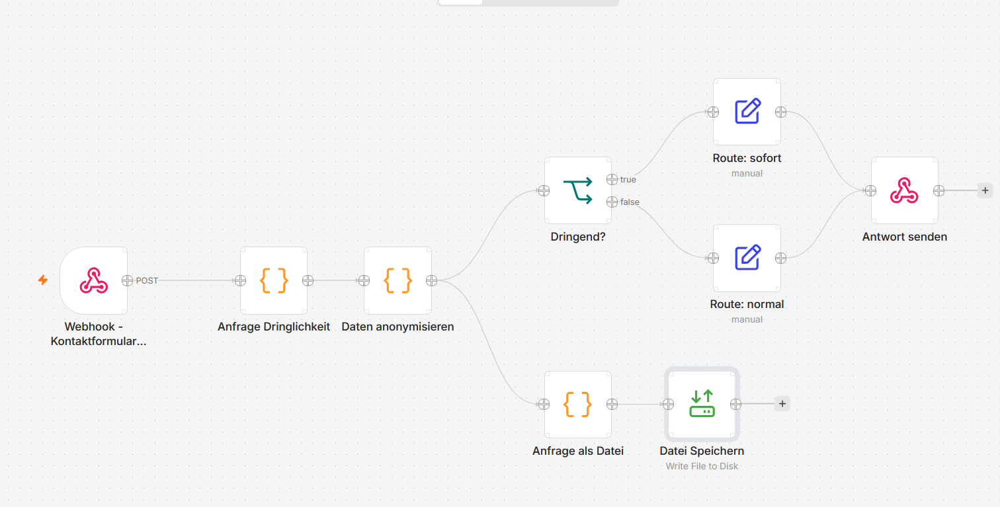

# 02 Kontaktanfragen einordnen: Webhook zu Antwort

English: request triage with anonymisation.



## Problem
Contact requests need to be sorted by type and urgency, and answered in a sensible order. They also contain personal data (names, e-mail addresses, phone numbers) that downstream steps do not need to see.

## Solution
A webhook receives a request as JSON (`name`, `email`, `nachricht`). A first Code node classifies it by keywords into one of five types and sets the urgency. A second Code node anonymises it: the name is reduced to initials, the e-mail field is masked, and e-mail addresses and phone numbers inside the message are replaced by `[E-MAIL]` and `[TELEFON]`. An If node routes urgent requests (job offers) to "answer today" and everything else to "answer within two days". The workflow replies to the caller with the result.

A side branch writes every anonymised request as a Markdown file, including a reply draft that matches the request type. A person reviews the draft and sends it. Nothing is sent automatically.

## Types and urgency

| Type | Urgency |
|---|---|
| Job offer (Jobangebot) | high |
| Project request (Projektanfrage) | medium |
| Question about tools (Frage zu Tools) | normal |
| Other (Sonstiges) | normal |
| Spam (links or spam words) | no reply needed |

## Nodes
1. **Webhook** (POST, path `kontakt`)
2. **Code**: classify type and urgency
3. **Code**: anonymise
4. **If**: urgent?
5. **Edit Fields** (two routes): route text
6. **Respond to Webhook**
7. Side branch: **Code** (Markdown file and reply draft), **Read/Write Files from Disk**

## Test it
With the workflow active, send a request, for example in PowerShell:

```powershell
Invoke-RestMethod -Method Post -Uri http://localhost:5678/webhook/kontakt -ContentType "application/json" -Body '{"name":"Anna Mueller","email":"anna@example.com","nachricht":"We have a job for you. Please call 0211 1234567"}'
```

The response contains the type, urgency, anonymised fields and the route.

## Notes
- Credentials are not part of the export.
- The classification is rule-based on purpose, so results are predictable. An AI model can replace the rules later, with a human still approving every reply.
- Runs locally. Connecting a live website form needs a publicly reachable n8n instance, which I have not set up.
- Tip for testing: send requests from a UTF-8 file when they contain umlauts, otherwise some terminals corrupt the characters before they reach n8n.
